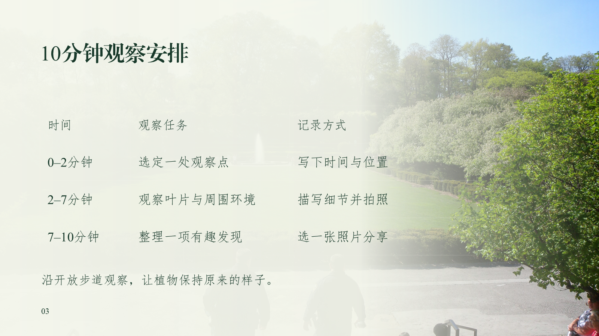

# 城市自然观察

4 页原创活动说明示例，使用 DeepSeek 版的实际联网搜图背景策略。

- [原始材料](input.md) 与 [需求设定](requirements.md)
- [可编辑 PPTX](sample.pptx) 与 [静态 PDF](sample.pdf)
- [原生动画预览 MP4](animation-preview.mp4)
- [图片来源与许可记录](asset-manifest.json)、[页面构建记录](build-record.json)、[内容配置](slides.json)

视频使用相同页面和原生效果自动触发，每页约 6 秒；PPTX 正文保留点击推进。该样例由维护环境制作，不作为 DeepSeek 官方客户端的模型实测结果。
